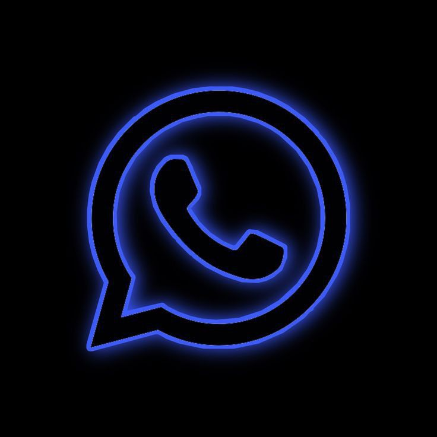

  

# Nova 🚀

Hoş geldin! 👋 
**Nova**, WhatsApp ve YouTube'dan ilham alan, ancak **tek farkı daha mavi ve daha tatlı** olan yeni nesil bir mesajlaşma ve içerik paylaşım uygulamasıdır. Amacımız, sana hızlı, güvenli ve eğlenceli bir iletişim deneyimi sunmak. 💙

## Kullanılan Teknolojiler 🛠️

## Neler Yapabilirsin? ✨
- 💬 **Gerçek Zamanlı Mesajlaşma:** Anlık mesajlar, sesli mesajlar ve medya paylaşımı.
- 📞 **Sesli ve Görüntülü Arama:** WebRTC altyapısı ile kesintisiz iletişim.
- 🎬 **Shorts (Kısa Videolar):** YouTube'dan ilham alan eğlenceli video akışı.
- 🌐 **Çoklu Dil Desteği:** Dünyanın dört bir yanından insanlarla tanış.
- 🎨 **Mavi ve Tatlı Arayüz:** Göz yormayan, modern ve şık bir tasarım.

## Ekran Görüntüleri 📸
*(Yakında eklenecek... Uygulamanın mavi ve tatlı arayüzünü sabırsızlıkla bekliyoruz! 💙)*

## Gizliliğine Önem Veriyoruz 🔐
Verilerinin güvenliği bizim için çok önemli. Uygulamamızın **KVKK uyumlu** gizlilik politikasına ve aydınlatma metnine [buradan](https://novapp1.netlify.app/) ulaşabilirsin. 📄

## Katkıda Bulun 🤝
Nova'yı daha iyi hale getirmek için fikirlerin mi var? Bir "Issue" (Sorun) açabilir veya "Pull Request" (Çekme İsteği) gönderebilirsin. Her türlü katkıya açığız! 💡

## Geliştirici 👨‍💻
**Murat Alp Yıldırım** tarafından sevgiyle geliştirildi. 💙
📧 **E-posta:** [muratalp200812@gmail.com](mailto:muratalp200812@gmail.com)

---
*Nova'yı tercih ettiğin için teşekkürler! Gelecek güncellemelerde görüşmek üzere...* 🚀
